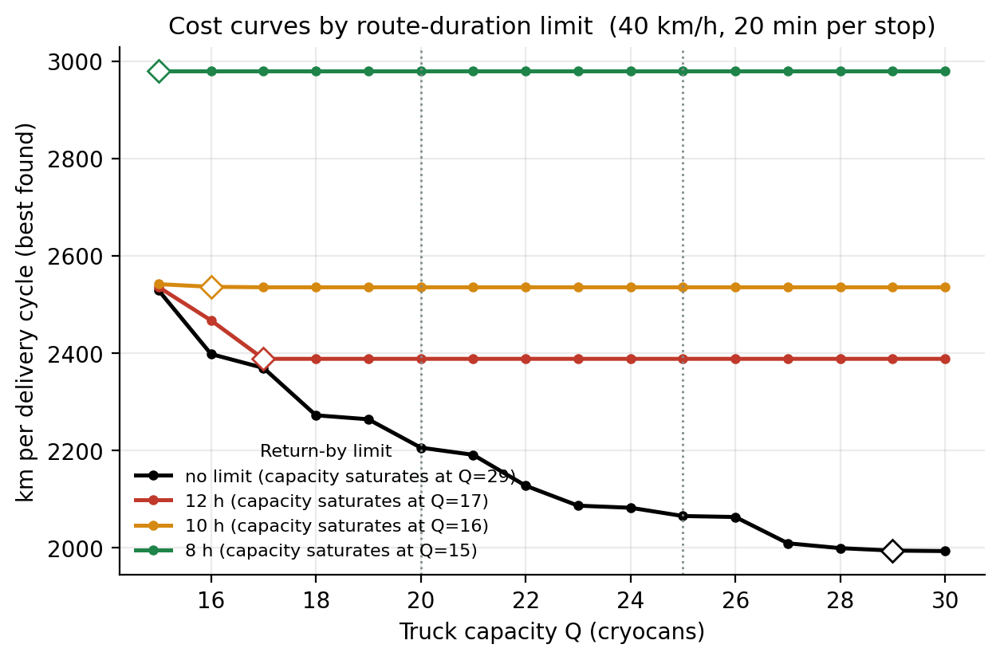

# Trucks, Time, and the Last Mile

**Capacity constraints and the cost of rural public-service delivery**

> *How do vehicle capacity and working-time constraints together determine the cost of delivering
> a public service across scattered rural locations, and who ends up bearing that cost?*

This repository re-analyses a real government logistics problem: how the Frozen Serum Laboratory
(FSL) of the Animal Husbandry Department in Nagpur, Maharashtra, delivers liquid nitrogen (LN₂) to
177 livestock centres using one hired truck. It starts by rebuilding the original spreadsheet
analysis exactly, then uses stronger optimisation methods to answer three policy questions:

1. How much does routing "by experience" cost compared with optimised routes?
2. Is it worth paying to make the truck bigger, and does the answer change once drivers must be
   home the same day?
3. Which villages account for most of the delivery cost, and who gains or loses when the rules change?

Every step is scripted, every assumption sits in one config file, and the original spreadsheet
numbers are checked automatically on every run.

---

## Table of contents

1. [Background: the problem in plain words](#1-background-the-problem-in-plain-words)
2. [Key findings at a glance](#2-key-findings-at-a-glance)
3. [Research question and hypotheses](#3-research-question-and-hypotheses)
4. [Glossary](#4-glossary)
5. [The data](#5-the-data)
6. [The model and why it is built this way](#6-the-model-and-why-it-is-built-this-way)
7. [The analysis pipeline, step by step (C0–C5)](#7-the-analysis-pipeline-step-by-step-c0c5)
8. [Cross-cutting design decisions](#8-cross-cutting-design-decisions)
9. [Assumptions register](#9-assumptions-register)
10. [Limitations](#10-limitations)
11. [Installation and running](#11-installation-and-running)
12. [Repository layout](#12-repository-layout)
13. [Output files: what each one contains](#13-output-files-what-each-one-contains)
14. [Tests](#14-tests)
15. [Using the code as a library](#15-using-the-code-as-a-library)
16. [How to change an assumption and re-run](#16-how-to-change-an-assumption-and-re-run)
17. [Source and citation](#17-source-and-citation)

---

## 1. Background: the problem in plain words

**Why liquid nitrogen?** Artificial insemination of cattle uses frozen semen, which must be stored
at −196 °C in liquid nitrogen. Each livestock centre keeps a **50-litre cryocan** (an insulated LN₂
container) that has to be swapped or refilled regularly, or the stored semen is lost.

**How it works today.** The FSL in Nagpur (the *depot*) hires **one TATA truck** at **Rs 19 per km**.
The truck carries **20 cryocans**. Staff planned **nine routes** from experience (the "status quo",
Table 1 of the case), which together visit all **177 locations**. These nine routes are driven
one after another, once per *delivery cycle*. A cycle repeats every **22–25 days in summer** (LN₂
evaporates faster in the heat) and every **30–35 days in winter**.

**The decision the department faced.** A carpenter could fit a partition that lets the truck carry
**25–26 cryocans** for a one-time cost of **Rs 20,000**. Is that worth it?

**What the original case did.** The teaching case (Choudhari & Chandra, 2022) gave students an Excel
workbook with a VBA macro implementing the Clarke-Wright savings algorithm. It produced routes of
2,336.7 km (at 20 cryocans) and 2,237.5 km (at 25), compared with 2,602 km for the status quo.

**What this project adds.**

* It **reproduces the spreadsheet exactly**, route by route, so every later number starts from a
  verified baseline.
* It uses **stronger solvers** (2-opt and Google OR-Tools) to estimate how far from the best
  achievable cost both the status quo and the spreadsheet are.
* It adds a **working-time constraint**, which the original case does not model: a driver who
  leaves at 8 a.m. should be back by 6 p.m. This turns out to change the answer to the retrofit
  question entirely.
* It asks **who bears the cost**: which villages are expensive to serve and how that changes.
* It tests how robust the answers are to seasonality, fuel prices, demand shocks and data problems.

---

## 2. Key findings at a glance

All numbers below come from the committed run (`quick` profile). They are in
`results/SUMMARY.md` and `results/key_numbers.json`.

| Finding | Number |
|---|---|
| Status quo (nine judgment-based routes) | **2,600.5 km per cycle** (2,602 km as published) |
| Spreadsheet savings model, reproduced exactly | 2,336.7 km (Q = 20), 2,237.5 km (Q = 25) |
| Best routes found, 20-cryocan truck | **2,206.0 km per cycle** |
| Gap between status quo and best | **394.5 km per cycle (15.2 %)**, about **Rs 1.0 lakh per year** |
| Share of that gap closed by the simple spreadsheet heuristic | 67 % |
| Retrofit 20 → 25 cryocans, no time limit | saves 140.5 km per cycle, **pays back in about 6.7 months** |
| Retrofit 20 → 25 cryocans, 10-hour working day | **saves 0 km**: the extra space is never used |
| Cost of requiring same-day return (10 h, Q = 20) | **329.5 km per cycle (14.9 %)**, about Rs 84,000 per year |
| Most remote 20 % of villages | carry **33 %** of route cost (Shapley allocation) |

**The main result in one sentence.** Capacity is worth a lot only if routes may run as long as
they need to; once drivers must return the same day, *time* becomes the binding limit, and a
bigger truck adds nothing.



*How to read this figure:* each line shows the best cost per cycle (y-axis) for each truck
capacity (x-axis). With no time limit (black line), cost keeps falling as the truck gets bigger,
up to about 29 cryocans. With a 10-hour limit (orange line), the curve is flat from 16 cryocans
onwards. The diamond marks the "saturation capacity", where extra space stops helping.

---

## 3. Research question and hypotheses

The research question is split into three testable hypotheses. Each one has an explicit, numeric
rule for "supported / not supported", written into the code (`analysis/report.py`) and printed next
to each verdict in `results/SUMMARY.md`.

*Why explicit rules?* A reader can then argue with the threshold rather than with a hidden
judgement call, and the verdict cannot quietly shift after seeing the results.

| | Hypothesis | Test (rule) | Verdict |
|---|---|---|---|
| **H1** | Judgment-based routing leaves a substantial efficiency gap. | Total gap ≥ 5 % of status-quo km. | **Supported** (15.2 %) |
| **H2** | The marginal value of capacity diminishes, and collapses once a same-day-return limit binds. | (a) average km saved per extra slot above Q = 20 is lower than at or below 20; **and** (b) retrofit value under the 10-hour limit is ≤ 25 % of its value without a limit. | **Supported** (64.7 vs 21.2 km per slot; 0 vs 140.5 km) |
| **H3** | Service costs concentrate in remote villages, and changes in capacity or time limits affect them disproportionately. | The most remote 20 % bear > 20 % of cost with a positive rank correlation to distance; a change counts as "disproportionate" if > 20 % of the reallocation falls on the most remote fifth **and** the change rises with distance. | **Partially supported** (concentration yes; only time-limit changes hit remote villages disproportionately, capacity changes do not) |

The analysis follows this narrative order:

```
judgment-based routing  →  optimisation benchmark  →  capacity and time constraints
                        →  cost structure and who bears it  →  policy counterfactuals
        (C0, C1)                 (C0)                       (C2, C3)
                                 (C4)                              (C5)
```

---

## 4. Glossary

| Term | Meaning in this project |
|---|---|
| **Depot** | The Frozen Serum Laboratory (FSL), Nagpur. Node `0` in the code. |
| **Location / village / customer** | One of the 177 livestock centres. Nodes `1`–`177`, numbered exactly as in the case. |
| **Cryocan** | A 50-litre LN₂ container. Each location needs one per visit. |
| **Route** | One trip of the truck: depot → several locations → depot. |
| **Delivery cycle** | Running all routes once, so every location is visited once. Costs are measured in **km per cycle**. |
| **Q (capacity)** | Number of cryocans the truck can carry on one route. Because each location needs exactly one cryocan, Q is also the **maximum number of stops per route**. |
| **H (duration limit)** | Maximum hours a route may take (e.g. 10 h = leave 8 a.m., back 6 p.m.). |
| **VRP / CVRP** | Vehicle Routing Problem / Capacitated VRP: choose routes that visit every customer once, respect the vehicle capacity, and minimise total distance. |
| **Clarke-Wright (CW) savings** | A classic 1964 heuristic. It starts with one round trip per location and repeatedly merges two routes where the merge saves the most distance: s(i, j) = d(0, i) + d(0, j) − d(i, j). |
| **2-opt** | A local improvement method: within a route, reverse a segment whenever that makes the route shorter (it removes "crossings"). |
| **OR-Tools** | Google's open-source optimisation library. Its routing solver builds an initial solution and then improves it with **Guided Local Search (GLS)** until a time limit runs out. |
| **Best found** | The cheapest *feasible* solution found by any method (see §8.1). Not a proven optimum. |
| **Marginal value of capacity, MV(Q)** | C(Q−1) − C(Q): km saved by adding the Q-th cryocan slot. |
| **Saturation capacity, Q\*(H)** | The smallest capacity beyond which extra slots save (almost) nothing under limit H. |
| **Price of same-day return** | C_H(Q) − C_∞(Q): extra km needed to obey a duration limit H. |
| **Marginal cost of a village, MC_i** | How much shorter the network becomes if village *i* is dropped. |
| **Shapley value** | A fair-division rule from game theory: each village's average contribution to route length over all orders in which villages could "join" the route. Shares add up exactly to the route length. |
| **Triangle inequality / metric** | A distance matrix is *metric* if going directly from A to B is never longer than going via C. This one often isn't (see §5.3). |
| **Metric closure** | Replacing each distance with the shortest path through any other locations (Floyd-Warshall algorithm). |
| **Break-even capex** | The most it is worth paying up front for a stream of future savings (present value). |
| **Payback period** | Months of savings needed to recover a one-time cost. |
| **[D] / [A]** | Tags in the config: **[D]** = number comes from the case data; **[A]** = an assumption made by this analysis. |

---

## 5. The data

### 5.1 Files in `data/raw/`

| File | What it is | Used for |
|---|---|---|
| `02_Main_Case_Data_File.xlsx` | The case's supplementary workbook ("RPAHD Data Files"). Sheet `Dmatrix`: 177 × 177 inter-location distances (km). Sheet `Demands`: distance from FSL, demand and name for each location. Sheet `Table 1`: the nine status-quo routes. | Everything: this is the main instance. |
| `01_IIM_Indore_project_for_SCM_MDP.xlsm` | The course spreadsheet model with the VBA savings macro. Sheets `Sort` (the sorted savings list), `Sheet20` and `Sheet25` (the macro's solutions). | Exact replication (C0) and tests. |
| `abc_warehouse.csv` | A small 13-shop public-distribution teaching example. | Unit tests only, because hand-checkable results are easier to verify on a tiny problem. |

### 5.2 How the data are loaded (`src/lastmile/data.py`)

Everything is turned into one `Instance` object:

* a single **(178 × 178)** symmetric distance matrix with the depot as row/column 0;
* a demand vector (`demand[0] = 0`, every location = 1);
* location names;
* a record of which matrix cells were stored as **text** in Excel.

*Why put the depot at index 0 and keep the case's numbering?* Node IDs then equal matrix indices
everywhere, so a route like `12-45-3` in the output can be compared directly with the case PDF
without any translation table. This removes a whole class of off-by-one bugs.

*Why record the text cells?* Five cells (e.g. d(149, 45) = `"51"`) are stored as text. Their
numeric value is used for all distances, but Excel sorts text after numbers, and that affects the
order in which the spreadsheet macro processes pairs. Without this detail the spreadsheet routes
cannot be reproduced exactly.

The loader also checks that the matrix is square and symmetric and that every node has a demand and
a label. *Why?* If the data are corrupted, it is better to fail at load time than to produce
quietly wrong routes.

### 5.3 Data quirks discovered (and what was done about them)

| Quirk | What was found | How it is handled |
|---|---|---|
| **The distance matrix is not metric** | For **58 %** of location pairs, there is a shorter path via a third location (average shortcut 8.6 km, maximum 82 km). The distances look partly hand-entered or mixed-source. | Headline results use the matrix *as supplied*, because that is the only way to reproduce the spreadsheet. C5 re-runs on the shortest-path version as a robustness check. C4 allows the truck to "drive through" a dropped village so marginal costs cannot go negative. |
| **Status-quo routes overfill the truck** | Four of the nine routes carry 24–28 cryocans on a 20-cryocan truck. | C1 reports two comparisons: at the official Q = 20, and at Q = 28 (what the status quo actually loads). |
| **Rounded published distances** | Table 1 sums to 2,602 km; the same routes measured on the matrix sum to 2,600.5 km. | Both are reported. All comparisons use 2,600.5 km so every plan is measured with the same ruler. |
| **Text-typed cells** | Five cells stored as text. | Read as numbers; text type kept only for the replication sort order. |
| **Table 3 in the case PDF** | Sample distances differ from the full matrix by up to 0.5 km. | The full matrix is used. |

---

## 6. The model and why it is built this way

The model lives in `src/lastmile/model.py`.

### 6.1 Network and demand

* Node 0 = depot, nodes 1–177 = locations; distances in km from the case workbook.
* **Demand = 1 cryocan per location per visit.**

*Why one cryocan?* That is what the case data say. A consequence is that capacity Q is the same
as "maximum stops per route", which makes results easy to interpret. Because real demand may vary,
C5 tests a stylised scenario where some locations need two.

### 6.2 Vehicle and cost

* One hired truck paid **per km**. Each *route* is one trip; routes are run one after another.
* **Cost = total km per cycle × Rs 19 per km × cycles per year.**

*Why is the number of routes not a fleet decision?* There is only one truck, and under a per-km
contract an extra trip costs only its kilometres. So the solver may use as many routes as it
likes, and only distance matters. In OR-Tools each "vehicle" stands for one trip of the same truck.

*Why minimise km, not time or number of trips?* The hire contract charges per km. There are no
fixed per-trip or crew costs in the data. Minimising km is therefore minimising what the
department actually pays.

### 6.3 Time (used from C3 onwards)

```
route duration = depot loading time + (route km ÷ speed) + (stops × stop time)
                 + extra minutes for each additional cryocan at the same stop
```

Base case: **40 km/h** and **20 minutes per stop**, depot time 0, 5 extra minutes per extra cryocan.
The headline limit is **10 hours** (8 a.m. to 6 p.m.).

*Why model time like this?* The data contain **no travel times at all**. A linear model with
an average speed and a fixed stop time is the simplest model that a reader can check by hand.
Because the inputs are guesses, they are never used as single values: C3 runs a full grid of
speeds (35/40/45 km/h) × stop times (15/20/30 min).

*Why a duration limit at all?* Long routes force drivers to stay overnight away from home. A
same-day-return rule is a realistic labour-welfare or safety policy, and the case itself mentions
that some routes cannot return the same day. Modelling the rule lets us put a price on it.

### 6.4 Problem and Solution objects

* `Problem` = instance + capacity + optional time model and duration limit + optional subset of
  customers. The subset makes "the same network **without** village *i*" a one-line operation
  (`problem.without(i)`), which C4 needs 177 times per scenario.
* `Solution` = a list of routes, with lazily computed km, loads, durations, and a `violations()`
  method that checks coverage (every location exactly once), capacity and duration.

*Why validate every solution?* Different solvers, repairs and cached results all flow into the
"best found" pool. A single check, applied to every candidate, guarantees that no infeasible plan
can ever be reported as best.

---

## 7. The analysis pipeline, step by step (C0–C5)

The analysis is split into six components. Each one is a module in `src/lastmile/analysis/` and
can be run on its own (`python -m lastmile c3`). They run in order because later components reuse
earlier solutions from the cache.

### C0 — Replication and solver benchmark (`c0_replication.py`)

**What it does**

1. **Rebuilds the status quo.** Loads the nine routes from Table 1, re-measures them on the matrix,
   and computes their durations and how much each overfills the truck.
2. **Reproduces the spreadsheet model exactly.** `solvers/savings_vba.py` is a line-by-line Python
   copy of the VBA macro. It checks:
   * the sorted savings list matches all **15,576** rows of the workbook's `Sort` sheet;
   * the totals match: **2,336.7 km** (Q = 20) and **2,237.5 km** (Q = 25);
   * **every route is identical**, node by node, in the same order and direction.
   If any check fails, the pipeline stops with a `ReplicationError`.
3. **Compares solvers** at Q = 20 and 25: spreadsheet CW, clean CW, CW + 2-opt, OR-Tools, best found.
4. **Convergence check.** Runs OR-Tools at 5, 15, 30, 60 and 120 seconds and records how both the
   cost and the retrofit value move with search time.

**Why replicate exactly before doing anything else?** If the new code cannot reproduce the
known answer, any difference later could be a bug rather than a finding. A route-by-route match
(not just a matching total) proves the data loading, distance handling and algorithm are all
right. It also lets the new results be compared fairly with the original course work.

**Why was reproducing the macro hard?** The macro has several behaviours that differ from the
textbook algorithm. They all had to be copied (details in `docs/replication_notes.md`):

* Excel's sort order: ties in saving are broken by distance, text cells sort last, and the sort is
  stable;
* the first pair always opens truck 1;
* an off-by-one error means the very last pair is never examined;
* **negative savings are used**: routes keep merging while capacity allows, even when that makes
  the tour longer;
* merged routes move between "truck slots" in a particular way, which affects the printed order;
* a `checklast` routine contains inverted logic (replicated, but never triggered on this data).

**Why keep a separate "clean" Clarke-Wright (`solvers/savings.py`)?** The macro's quirks are
right for replication but wrong for analysis (e.g. accepting negative savings, ignoring time).
The clean version uses only positive savings, examines every pair, and checks the duration limit
at every merge. On this data it gives the same totals as the macro at Q = 20 and 25.

**Why these solvers?**

| Solver | Why it is included |
|---|---|
| Spreadsheet CW | The benchmark the department/course actually had. |
| Clean CW | A transparent, textbook heuristic that a planner could run in Excel. Shows what a simple rule achieves. |
| CW + 2-opt | Cheap improvement: removes zig-zags inside routes. Shows how much is lost purely in stop *order*. |
| OR-Tools (GLS) | A state-of-the-art metaheuristic that also moves stops *between* routes. Estimates how close to optimal we can get. Supports both capacity and time dimensions natively. |

**Why a convergence check?** OR-Tools with a time limit gives different answers with different
search times. If the retrofit value (C(20) − C(25)) swung wildly with search time, capacity
conclusions would be artefacts of the solver. The table `c0_retrofit_value_vs_effort.csv` shows
it stays between about 108 and 178 km across budgets: positive and substantial, but with real
uncertainty, which is why the curves use the equal-effort procedure described in §8.2.

**Results:** best found 2,206.0 km (Q = 20) and 2,054.2 km (Q = 25). OR-Tools alone at 15 s gives
2,293 km at Q = 20; the extra improvement comes from the solution pool and continuation sweeps.

---

### C1 — The cost of rules of thumb (`c1_gap.py`)

**What it does.** It splits the total gap between status quo and best into two parts:

```
Total gap = (Status quo − Savings heuristic)   "judgment vs a simple rule"
          + (Savings heuristic − Best found)   "simple rule vs full optimisation"
```

It does this twice:

* **Nominal** — heuristic and best at Q = 20 (the official truck size);
* **Capacity-matched** — at Q = 28, the largest load the status quo actually puts on the truck.

**Why decompose the gap?** The policy implication differs. If most of the gap is closed by a simple
spreadsheet heuristic, the department doesn't need sophisticated software, just a systematic rule.
If most of it needs advanced optimisation, the case for investing in software is stronger.

**Why a capacity-matched comparison?** The status quo overfills the truck (up to 28 cryocans).
Comparing it with plans restricted to 20 would be unfair *to the optimiser*. Comparing at 28 gives
the optimiser the same capacity the status quo borrows, so the remaining gap is due purely to
routing judgment. If the gap disappeared at Q = 28, the "inefficiency" would just be overfilling.

**Why use the best known solution here (regardless of search effort)?** C1 measures the gap to
the best plan anyone could adopt, so the best solution ever found is the right comparison.

**Results.**
* Nominal: gap **394.5 km per cycle = 15.2 %**, about **Rs 1,00,344 per year** at mid frequency.
  The simple savings heuristic closes **67 %** of it; full optimisation closes the other **33 %**.
* Capacity-matched (Q = 28): gap **23.1 %**. The gap grows rather than disappearing, so it is not an
  artefact of overfilling.

---

### C2 — Capacity–cost trade-off (`c2_capacity.py`)

**What it does**

1. Computes the cost curve **C(Q)** for every capacity from 15 to 30, **with no time limit**.
2. Computes the **marginal value** of each slot: MV(Q) = C(Q−1) − C(Q).
3. Builds a **break-even (willingness-to-pay) curve**: the most it is worth paying once to go from
   Q = 20 to Q, equal to the present value of the annual saving
   `(C(20) − C(Q)) × Rs 19 × cycles per year`, over 1, 3 and 5 years at an 8 % discount rate.
4. Evaluates the actual **Rs 20,000 retrofit** to Q = 25 (and 26): annual saving, payback, 1-year NPV.

**Why a whole curve instead of just Q = 20 vs 25?** A single comparison cannot show *diminishing*
returns or where capacity stops mattering. The curve answers "what is the next slot worth?" at every
size, which is exactly hypothesis H2.

**Why a break-even curve rather than an "optimal truck size"?** There are no cost data for larger
trucks; only one per-km rate is known. Picking an "optimal" size would require inventing those
costs. The break-even curve instead says: *any* upgrade cheaper than this line pays for itself.
A decision-maker can then compare it with real quotes.

**Why is the 1-year horizon the conservative one?** The truck is hired on a **yearly contract**.
A partition fitted to a hired truck may not carry over to next year's vehicle, so the department
should expect to recover the cost within one year.

**Why an 8 % discount rate?** It is a typical real public-sector discount rate. It barely matters
here because the payback is under a year.

**Results.**
* Average marginal value: **64.7 km per slot** for Q ≤ 20 versus **21.2 km per slot** for Q > 20 —
  diminishing, as H2 predicts. Capacity saturates at Q = 29.
* Retrofit to 25: saves **140.5 km per cycle ≈ Rs 35,700 per year**; payback **6.7 months**;
  break-even 1-year value Rs 33,090, above the Rs 20,000 cost. **Worth it — if there is no time limit.**

*Note:* C2 reports C(25) = 2,065.5 km, while C0 reports a best of 2,054.2 km. The difference is
deliberate: C2 uses equal search effort at every capacity (§8.2), whereas C0 reports the best ever
found, including long 120-second runs.

---

### C3 — The time constraint (headline result) (`c3_duration.py`)

**What it does**

1. **Cost curves by duration limit.** Repeats the C2 sweep (Q = 15…30) under limits of 8, 10 and
   12 hours (9 h in the `full` profile) plus "no limit", at 40 km/h and 20 min per stop.
2. **Saturation capacity Q\*(H).** For each limit, the smallest Q whose cost is within
   max(1 km, 0.25 %) of the cost at Q = 30.
3. **Price of same-day return** = C_H(Q) − C_∞(Q), in km and rupees per year.
4. **Efficiency vs balanced service.** For the status quo and the best plans (Q = 20/25, with and
   without the 10-h limit): number of routes, longest/shortest route, coefficient of variation
   of route length, longest duration, routes that cannot return the same day, and truck-days per cycle.
5. **Sensitivity.** Repeats the key numbers for speeds {35, 40, 45} × stop times {15, 20, 30} at 10 h.
6. **Calibration against the case narrative.** The case says only routes 3 (Kuhi) and 9 (Mansar)
   cannot return the same day. For each speed, it computes the range of stop times under which
   *exactly* those two status-quo routes exceed the working day.

**Why is this the headline component?** The original case treats capacity as the only constraint.
In reality, a truck that can carry more cryocans only helps if a route has time to visit more
stops. Adding time is what changes the policy answer, so it is the core contribution.

**Why sweep tight limits first?** Solutions feasible under 8 h are also feasible under 10 h, so
solving tight limits first gives the looser ones a good starting pool (§8.1).

**Why a tolerance in the saturation definition?** Heuristic costs move by a km or so with noise.
Without a small tolerance, "saturation" would be decided by a rounding difference.

**Why measure balance and overnight stays?** Minimising total km can create a few very long routes.
That is cheaper but harder on drivers and riskier for the cargo. Reporting both efficiency and balance
shows the trade-off rather than hiding it.

**Why a calibration check?** It tests whether the assumed speeds and stop times are consistent with
what the case reports. If they aren't, that should be said openly rather than buried.

**Results.**
* **Under a 10-h limit, the retrofit saves 0 km.** At 40 km/h and 20 min per stop, routes hit the
  10-hour limit after about 17 stops, so slots 18–25 are never used (max load at Q = 20 is 17).
  Saturation capacity: **16** (10 h), **17** (12 h), **15** (8 h), versus **29** with no limit.
* **Price of same-day return at Q = 20, 10 h: 329.5 km per cycle (14.9 %) ≈ Rs 83,800 per year.**
  Without a limit, the best Q = 20 plan has **8 routes that cannot return the same day** (longest 14.3 h).
* With an **8-hour limit**, the best plan (2,979.5 km) is *longer* than the status quo (2,600.5 km).
  The status quo is "cheap" partly because six of its routes run overnight.
* **Sensitivity:** across all speed × stop combinations, the price of same-day return ranges from
  3 % to 44 %, and the retrofit value under the 10-h limit is 0 km in every combination. The
  headline finding does not depend on the exact time assumptions.
* **Calibration:** at 40 km/h with a 10-h day, the case narrative would require stops of only
  0–3.3 minutes, which is implausible. Either the working day in practice is longer, or
  "overnight" in the case means something looser. This is reported in the summary, not hidden.

---

### C4 — Who bears the cost (`c4_incidence.py`, `allocation.py`)

**What it does.** For four scenarios — Q ∈ {20, 25} × {no limit, 10 h} — it measures each
village's cost in two complementary ways:

1. **Marginal cost** MC_i = C(all) − C(all except i). "How much would the network save without village i?"
   C(all except i) is the cheapest of:
   * drop *i* from its route and re-optimise that route with 2-opt;
   * OR-Tools warm-started from that for a few seconds (in the `full` profile);
   * **drive through** *i*'s location without stopping (keep the old path).
2. **Shapley share**: each village's fair share of its own route's length, computed **exactly**.

Then it measures concentration: cost share by remoteness quintile (distance from FSL), the share of
the most remote 20 %, a Gini coefficient, and Spearman rank correlation with distance. Finally it
compares scenarios that differ in **only one** dimension (capacity *or* time limit) and asks which
villages gain or lose.

**Why two measures?** They answer different questions:
* *Marginal cost* is a planner's question: what does adding or dropping this village cost the
  system? It is very sensitive to neighbours: a remote village next to another remote village is
  cheap at the margin because the truck is going there anyway.
* *Shapley share* is a fairness/accounting question: if the route's bill had to be split among the
  villages on it, what is each village's fair part? It always adds up to the total, so changes in it
  are genuine shifts of the bill from one village to another.

This explains why the correlation with distance is much stronger for Shapley (ρ = 0.72) than for
marginal cost (ρ = 0.24).

**Why add the "drive-through" option?** Because the matrix is not metric, removing a stop can make
the direct link *longer* than the detour (e.g. A→i→B shorter than A→B). Then a naive re-solve would
give a *negative* marginal cost, which makes no sense: the truck could always just drive the old
road. Taking the minimum with "drive through" guarantees MC_i ≥ 0.

**Why a local re-optimisation rather than a full re-solve?** It is closer to what a planner would
actually do (drop a village from an existing plan) and avoids heuristic noise: 177 independent full
re-solves would each vary by tens of km, larger than most individual marginal costs.

**Why exact Shapley values?** Shapley values normally require averaging over all orderings of the
players, which is impossible for 20+ villages, so people usually sample. Here, because the route
order is fixed, the cost of any subset is a sum of "edge used" terms, and each term has a known
closed-form Shapley value. Summing gives the **exact** answer in polynomial time (O(m³) per route).
The tests compare it with brute-force enumeration on small routes.

**Why compare only one-dimensional changes?** If capacity and the time limit changed together,
we couldn't tell which one caused the shift.

**Results (Q = 20, no limit).**
* The most remote 20 % of villages carry **33 %** of route cost (Shapley) and **35 %** of summed
  marginal costs. Remoteness strongly predicts Shapley share (ρ = 0.72).
* **Adding the 10-h limit** shifts the bill disproportionately onto remote villages: 34 % of the
  reallocation (Q = 20) and 40 % (Q = 25) falls on the most remote fifth, rising with distance (ρ ≈ 0.44–0.51).
* **Adding capacity** (20 → 25, no limit) does *not*: only 13 % of the reallocation falls on the
  most remote fifth, with no relation to distance (ρ = 0.09).
* Under the 10-h limit, Q = 20 and Q = 25 give **identical routes**, so nothing shifts — consistent with C3.
* Hence H3 is **partially supported**.

---

### C5 — Robustness and counterfactuals (`c5_robustness.py`, `economics.py`)

**What it does**

1. **Seasonality.** Converts km per cycle into rupees per year using low / mid / high cycles per
   year: **12.5 / 13.4 / 14.4**. These come from the case's visit intervals (22–25 days in summer,
   30–35 days in winter), with the year split into 183 summer-like and 182 winter-like days.
   For example, mid = 183 ÷ 23.5 + 182 ÷ 32.5 ≈ 13.4.
2. **Rate and diesel sensitivity.** Hire rate from Rs 15 to 25/km; diesel shocks from −20 % to +40 %,
   assuming 60 % of the hire rate moves with fuel prices.
3. **Stylised demand shock.** In summer, a random 10 % or 25 % of locations need **two** cryocans
   (random draws, fixed seed). Clearly labelled *STYLISED* in all outputs.
4. **Metric closure.** Re-solves everything on the shortest-path version of the matrix.
5. **Statewide extrapolation.** Scales Nagpur's savings to 35 other districts at 0.5–1.5× — labelled
   *illustrative only*.

**Why each check?**

| Check | The worry it addresses |
|---|---|
| Seasonality range | Annual savings depend on how often the cycle runs, which is only given as a range. Carrying low/mid/high through shows the conclusion holds at both ends. |
| Rate and diesel | Rs 19/km may change at the next contract renewal. Does the retrofit still pay back within a year at lower rates? |
| Demand shock | "One cryocan per location" may be too simple; heavier summer demand could make capacity more valuable. |
| Metric closure | The non-metric matrix might make the status quo look artificially bad or the optimiser artificially good. |
| Extrapolation | Gives an order-of-magnitude sense of statewide stakes, while making clear it is not evidence. |

**Why a fixed random seed?** So the "random" demand shocks are the same every time and results are reproducible.

**Why assume 60 % of the rate is fuel?** There is no breakdown of the hire rate. 60 % is a plausible
share for a hired truck, and the result is shown for a range of shocks so the reader can see how much it matters.

**Results.**
* Annual saving from optimised routing (Q = 20, no limit): **Rs 93,800 – 1,07,800**.
* Retrofit payback without a time limit: **6.2 – 7.2 months** across the seasonal range.
* With a 10-h limit, the retrofit never pays back (no saving) in any seasonal case.
* Demand shock: with no time limit, the retrofit becomes *more* valuable (161–208 km per cycle). Under
  the 10-h limit it stays near zero (0–7.75 km), so the headline conclusion survives.
* Shortest-path matrix: the status-quo gap falls from 15.2 % to **11.4 %**, the retrofit value rises
  slightly to **151 km**. The conclusions don't depend on the matrix quirks.
* Statewide (illustrative): roughly Rs 16 lakh – 57 lakh per year from optimised routing with no time limit.

---

### Report (`report.py`)

Reads `results/key_numbers.json` (written by C0–C5) and writes `results/SUMMARY.md`, including each
hypothesis verdict and the rule used.

*Why generate the summary from saved numbers?* So the written results can never drift from the
computed ones, and the summary can be rebuilt in seconds (`make report`) without re-solving anything.

---

## 8. Cross-cutting design decisions

### 8.1 "Best found" = solver portfolio + solution pool

`RoutingEngine.best(problem)` (in `solvers/__init__.py`) returns the cheapest feasible solution among:
Clarke-Wright, CW + 2-opt, OR-Tools, and a **pool** of every feasible solution seen earlier for the
same network.

*Why a pool?* A solution feasible with 20 cryocans is also feasible with 21, and a solution feasible
under an 8-hour limit is also feasible under 10 hours. If the solver happened to find a worse answer at
Q = 21 than at Q = 20, it would look as if extra capacity *increased* cost, which is impossible. Re-using
all previous feasible solutions guarantees that cost curves never go up as constraints loosen, so
heuristic noise cannot masquerade as a negative value of capacity.

### 8.2 Continuation sweeps with equal search effort

A cold-start OR-Tools run of 15 seconds can vary by ±50 km at Q = 20, as large as the effect of one
cryocan slot. To make cost curves meaningful, `RoutingEngine.sweep()` solves a whole family of
capacities together:

* **Up-pass** (Q ascending): warm-start OR-Tools from the best solution at Q−1 (always feasible at Q).
* **Down-pass** (Q descending): take the best at Q+1, **repair** it to fit Q (`solvers/repair.py`
  removes the stops that save the most distance from overfull routes and re-inserts them at the
  cheapest feasible spot), then warm-start OR-Tools from it.
* A final pass takes the best of everything, giving a monotone curve.

Pool entries remember how many seconds of search produced them. By default, solutions from longer
runs (e.g. the 120 s convergence runs in C0) are **excluded** from the curves.

*Why?* If one capacity level benefited from a 120-second run and its neighbours didn't, the curve would
show a bump caused by extra search time rather than capacity. Equal effort keeps comparisons fair.

### 8.3 Exact arithmetic for time feasibility in OR-Tools

OR-Tools needs integers. Distances are scaled ×100 (the data have at most 2 decimals, so this is exact).
Travel and service times are converted to tenths of a minute and **rounded up**.

*Why round up?* Rounding up makes OR-Tools slightly conservative: any route it accepts is also feasible
when re-checked in exact arithmetic by `Solution.violations()`. Rounding to nearest could let through
routes that are a few seconds over the limit.

### 8.4 Warm starts and fall-backs

If OR-Tools cannot find a first solution, it retries with a different first-solution strategy
(`PATH_CHEAPEST_ARC`) and then with more vehicles. *Why?* Tight time limits can make the default
start strategy fail; the fall-backs make the pipeline robust without manual intervention.

The methodology notes that warm-starting OR-Tools from the spreadsheet solution was tried and got stuck
in a worse local optimum than a cold start, so cold starts plus the pool are used for single solves.

### 8.5 Caching

Every solve is appended to `results/cache/solutions.jsonl`, keyed by a hash of the problem (data
fingerprint, capacity, time model, limit, customer subset) and the method.

*Why?* The full pipeline takes 1.5–2 hours. With the cache, re-running a component or regenerating
figures takes seconds. It also makes the committed numbers reproducible, because OR-Tools with a
time limit is not bit-for-bit deterministic across machines.

### 8.6 One config file, every assumption tagged

All numbers are in `config/default.toml`, each tagged **[D]** (from the case) or **[A]** (assumption).
*Why?* A reader can see instantly which numbers are facts and which are choices, and can change any
choice without touching the code.

### 8.7 Profiles

| Profile | Purpose | OR-Tools budget | Approx. run time |
|---|---|---|---|
| `smoke` | Check the pipeline end to end (CI) | 1 s | ~1 minute |
| `quick` | The committed results | 15 s (5 s for time-limited sweeps) | ~1.5–2 hours, single core |
| `full` | Recommended for a final paper | 60 s (30 s time-limited) + more convergence points | ~6–8 hours |

*Why profiles?* The same code serves quick checks and publication-quality runs; only the search
budget changes.

---

## 9. Assumptions register

| Assumption | Value | Type | Why this value |
|---|---|---|---|
| Hire rate | Rs 19/km | [D] | Case Table 2. Varied Rs 15–25 in C5. |
| Baseline capacity | 20 cryocans | [D] | Case Table 2. |
| Retrofit | Rs 20,000 → 25 cryocans | [D] | Case Table 2 footnote ("five to six extra"); lower end used, 26 also reported. |
| Visit intervals | 22–25 days (summer), 30–35 days (winter) | [D] | Case p. 42. |
| Split of the year | 183 summer / 182 winter days | [A] | Simplest even split; gives 12.5–14.4 cycles per year. |
| Demand | 1 cryocan per location | [D] | Case data. Stylised two-cryocan shock in C5. |
| Discount rate | 8 % real | [A] | Typical public-sector rate; little effect given sub-1-year payback. |
| Horizons | 1, 3, 5 years | [A] | 1 year matches the yearly truck contract (conservative). |
| Fuel share of rate | 60 % | [A] | Plausible for a hired truck; shocks −20 % to +40 % shown. |
| Speed | 40 km/h (35–45 range) | [A] | No travel times in data; typical rural Indian road speed for a loaded truck. |
| Stop time | 20 min (15–30 range) | [A] | Time to swap/refill one 50 L cryocan and do paperwork. |
| Extra time per additional cryocan | 5 min | [A] | Used only in the demand-shock scenario. |
| Working day | 10 h headline (8, 9, 12 also run) | [A] | 8 a.m. departure, 6 p.m. return. |
| Saturation tolerance | max(1 km, 0.25 %) | [A] | Above heuristic noise, below one slot's typical value. |
| Demand-shock share | 10 %, 25 % of locations | [A] | Illustrative; no data on variable demand. |
| Other districts | 35, at 0.5–1.5× Nagpur | [A] | Maharashtra's district count; scale range is a guess and labelled as such. |

---

## 10. Limitations

Stated up front, so results are read with the right confidence (details in `docs/data_limitations.md`):

* **No travel times.** Durations come from assumed speeds and stop times. Treated as ranges.
* **One per-km rate.** No data on larger trucks or fixed per-trip costs, so capacity is valued with a
  break-even curve rather than an "optimal" truck size.
* **One cryocan per location.** Variable demand is only explored through a stylised scenario.
* **One district.** External validity is unknown; statewide figures are illustrative.
* **Non-metric distance matrix.** Handled by replicating with the raw matrix and re-solving on the
  shortest-path closure.
* **No optimality certificate.** "Best found" is heuristic. Convergence tables show how much numbers
  could move with more search; the `full` profile searches longer.
* **Calibration tension.** The case's overnight narrative and the assumed time ranges are hard to
  reconcile (see C3). Reported, not hidden.

---

## 11. Installation and running

**Requirements:** Python **3.11 or newer** (the config loader uses the built-in `tomllib`).
Dependencies: numpy, pandas, scipy, matplotlib, openpyxl, ortools (and pytest, ruff for development).

```bash
# 1. Install (editable, with dev tools)
pip install -e ".[dev]"            # or: make install

# 2. Run the fast tests (~5 s, includes the exact replication)
make test

# 3. Check the whole pipeline end to end (~1 min, writes to results_smoke/)
make smoke

# 4. Reproduce the committed results (~1.5-2 h single core the first time; seconds afterwards thanks to the cache)
make all

# 5. Longer, publication-quality search (~6-8 h)
make all PROFILE=full
```

**Running individual pieces**

```bash
python -m lastmile c0                      # one component: c0 c1 c2 c3 c4 c5 report
python -m lastmile c2 c3 --profile full    # several components, another profile
python -m lastmile all --no-cache          # ignore the cache and re-solve everything
python -m lastmile solve --capacity 25 --shift-hours 10   # one ad-hoc solve, prints routes and durations
make replicate                             # C0 only
make report                                # rebuild SUMMARY.md from saved numbers
make clean-cache                           # forget cached solutions (forces fresh searches)
```

After `pip install -e .`, the command `lastmile ...` works as a shortcut for `python -m lastmile ...`.

---

## 12. Repository layout

```
config/default.toml        every assumption, tagged [D] data or [A] assumption; profiles smoke/quick/full
data/raw/                  case workbook, spreadsheet model (.xlsm), ABC teaching instance (tests)
docs/
  methodology.md           methods per component (compact reference)
  replication_notes.md     how the spreadsheet was reproduced; VBA quirks; data quirks
  data_limitations.md      limits of the data and how each is handled
src/lastmile/
  data.py                  Instance (depot = node 0), loaders, savings matrix, metric closure
  model.py                 TimeModel, Problem (capacity, duration limit, customer subset), Solution
  solvers/
    savings_vba.py         line-by-line replica of the spreadsheet macro (exact replication)
    savings.py             clean Clarke-Wright with capacity + duration checks
    two_opt.py             intra-route 2-opt
    ortools_vrp.py         OR-Tools CVRP with optional time dimension and warm starts
    repair.py              make a solution feasible for a tighter problem
    __init__.py            RoutingEngine: portfolio, cache, solution pool, continuation sweep
  allocation.py            exact route-level Shapley values, detour costs, concentration, Gini
  economics.py             seasonality, annualisation, break-even, payback, fuel shocks
  plotting.py              shared figure style
  config.py                loads the TOML config and applies a profile
  analysis/
    common.py              Context: settings + instance + engine + output helpers
    c0_replication.py ... c5_robustness.py   one module per component
    report.py              writes results/SUMMARY.md
  cli.py, __main__.py      python -m lastmile ...
tests/                     replication, solvers, Shapley vs brute force, economics, config, data
scripts/example_usage.py   using the library directly
results/                   committed outputs (tables, figures, SUMMARY.md, key_numbers.json, cache)
Makefile, pyproject.toml, requirements.txt
```

---

## 13. Output files: what each one contains

All outputs go to `results/` (`results_smoke/` for the smoke profile).

| File | Contents |
|---|---|
| `SUMMARY.md` | Headline numbers, hypothesis verdicts and the rules behind them. **Start here.** |
| `key_numbers.json` | Every headline number in machine-readable form. |
| `cache/solutions.jsonl` | Every solution found (routes, km, method, search effort). |
| **C0** | |
| `tables/c0_replication.csv` | Target vs reproduced km for the status quo and spreadsheet; route-identity flags. |
| `tables/c0_status_quo_routes.csv` | The nine routes: stops, reported vs matrix km, duration, overfill. |
| `tables/c0_solver_comparison.csv` | Each solver at Q = 20 and 25: km, routes, max load, time, % vs spreadsheet. |
| `tables/c0_convergence.csv`, `figures/c0_convergence.png` | OR-Tools cost vs time limit. |
| `tables/c0_retrofit_value_vs_effort.csv` | Retrofit value at matched search effort. |
| **C1** | |
| `tables/c1_gap_decomposition.csv`, `figures/c1_gap_decomposition.png` | Judgment vs heuristic vs best, nominal and capacity-matched. |
| **C2** | |
| `tables/c2_capacity_sweep.csv`, `figures/c2_cost_curve.png` | C(Q), marginal values, route statistics. |
| `tables/c2_breakeven.csv`, `figures/c2_breakeven_curve.png` | Annual savings and break-even capex by capacity. |
| `tables/c2_retrofit_evaluation.csv` | Retrofit to 25/26: saving, payback, worth it on a 1-year horizon. |
| **C3** | |
| `tables/c3_cost_curves_by_time_limit.csv`, `figures/c3_headline_cost_curves.png` | C(Q) under each limit; price of same-day return. |
| `tables/c3_time_limit_summary.csv` | Per limit: C(20), C(25), retrofit value, saturation capacity, price of same-day return. |
| `tables/c3_sensitivity_speed_stop.csv`, `figures/c3_sensitivity_heatmaps.png` | Speed × stop-time grid. |
| `tables/c3_route_balance.csv`, `figures/c3_route_balance.png` | Route length/duration balance, overnight routes. |
| `tables/c3_calibration_implied_stop_time.csv` | Stop-time ranges consistent with the case narrative. |
| `tables/c3_status_quo_overnight_by_assumption.csv` | Which status-quo routes run overnight under each assumption. |
| **C4** | |
| `tables/c4_village_costs.csv` | Per village and scenario: marginal cost, Shapley share, detour, stand-alone cost, remoteness. |
| `tables/c4_incidence_summary.csv`, `figures/c4_cost_share_by_remoteness.png` | Concentration by remoteness quintile, Gini, Spearman ρ. |
| `tables/c4_allocation_shifts.csv`, `figures/c4_allocation_shifts.png` | Who gains/loses when capacity or the time limit changes. |
| `figures/c4_cost_vs_distance.png` | Scatter of village costs against distance from the lab. |
| **C5** | |
| `tables/c5_seasonality_payback.csv`, `figures/c5_retrofit_payback.png` | Annual savings and retrofit payback by season case and limit. |
| `tables/c5_rate_fuel_sensitivity.csv` | Savings and payback across hire rates and diesel shocks. |
| `tables/c5_demand_shock_runs.csv`, `tables/c5_demand_shock_summary.csv` | Stylised demand-shock results. |
| `tables/c5_metric_closure.csv` | Raw vs shortest-path matrix comparison. |
| `tables/c5_extrapolation.csv` | Illustrative statewide range. |

---

## 14. Tests

```bash
make test        # fast tests, no long OR-Tools searches
make test-all    # also runs short OR-Tools solves (marked "slow")
```

| Test file | What it guarantees | Why it matters |
|---|---|---|
| `test_replication.py` | Sort order matches all workbook rows; Q = 20/25 spreadsheet solutions reproduced route by route; status-quo distance correct. | The verified baseline everything else rests on. |
| `test_data.py` | Matrix shape and demand; text cells detected; Table 1 parsed; ABC savings match the teaching PDF; metric closure never lengthens a distance. | Catches data-loading errors early. |
| `test_model.py` | Duration formula; extra-cryocan time; violations detected; route distance symmetric; `without()` works. | The building blocks of every solve. |
| `test_solvers.py` | CW feasible and better than out-and-back; 2-opt never worse and fixes a crossing; duration limit respected; OR-Tools respects capacity and duration; pool makes costs monotone; subsets work. | Solver correctness and the monotonicity guarantee. |
| `test_allocation.py` | Exact Shapley equals brute-force enumeration on random routes; concentration measures stay within bounds. | Validates the closed-form shortcut. |
| `test_economics.py` | Cycles per year, break-even, payback, fuel shocks. | Rupee figures are only as good as these formulas. |
| `test_config.py` | Profiles override the defaults correctly. | Ensures `quick`/`full`/`smoke` actually change what they claim. |

---

## 15. Using the code as a library

`scripts/example_usage.py` shows the main pieces:

```python
from lastmile.allocation import shapley_allocation
from lastmile.config import REPO_ROOT
from lastmile.data import load_case_instance
from lastmile.model import Problem, TimeModel
from lastmile.solvers import RoutingEngine, solve_vba

inst = load_case_instance(REPO_ROOT / "data/raw/02_Main_Case_Data_File.xlsx")

# 1. The spreadsheet's own algorithm, replicated exactly
print(solve_vba(Problem(inst, 20)).summary())

# 2. Best solution with a 10-hour same-day-return rule (40 km/h, 20 min per stop)
engine = RoutingEngine(ortools_time_limit_s=5)
problem = Problem(inst, capacity=25, time=TimeModel(speed_kmh=40, stop_min=20), max_duration_min=600)
best = engine.best(problem)
print(best.summary(), best.balance_stats())

# 3. Who pays: exact Shapley share of each village within its route
shares = shapley_allocation(best)
```

To use a different network, build an `Instance` with your own distance matrix (depot at index 0),
demand vector and labels; everything else works unchanged.

---

## 16. How to change an assumption and re-run

1. Edit the value in `config/default.toml` (e.g. `stop_min = 25.0` under `[time]`), or add an
   override under a profile.
2. Run the affected components, e.g. `python -m lastmile c3 c4 c5 report`.
   The cache is keyed by the full problem definition, so changed problems are solved afresh while
   unchanged ones are reused automatically.
3. Read the updated `results/SUMMARY.md`.

Keep `distance_mode = "raw"` if you want C0's replication checks to pass; `"metric"` is meant only
for robustness runs.

---

## 17. Source and citation

Choudhari, S., & Chandra, S. (2022). Route Planning at an Animal Husbandry Department.
*INFORMS Transactions on Education*, 23(1), 41–45. https://doi.org/10.1287/ited.2021.0250cs
(CC BY-SA 4.0). Distance data: "RPAHD Data Files" supplementary workbook.

Methods referenced: Clarke, G. & Wright, J. W. (1964), *Scheduling of vehicles from a central depot
to a number of delivery points*, Operations Research 12(4); Croes, G. A. (1958), *A method for
solving traveling-salesman problems*, Operations Research 6(6); Google OR-Tools routing library;
Shapley, L. S. (1953), *A value for n-person games*.
